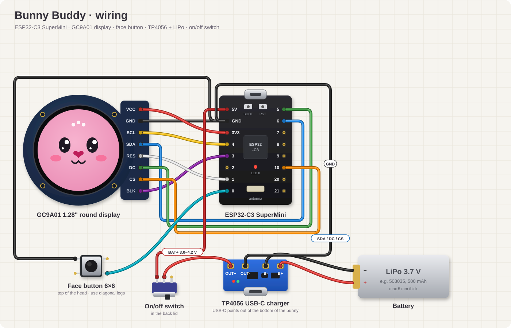

# Bunny Buddy 🐰

A tiny desk companion: a 3D-printed bunny with a round 1.28" screen for a face. It shows 17 animated expressions, works as a countdown timer, stopwatch and clock with live weather, and runs on a rechargeable battery.



## Features

- **17 animated faces**: Smile, Happy, Laugh, Love, Kiss, Wink, Surprised, Star-struck, Sleepy, Shy, Sad, Cry, Angry, Dizzy, Nervous, Suspicious and Carrot. The bunny blinks, looks around and twitches its nose on its own.
- **Auto mode** cycles through the faces every 7 seconds.
- **Countdown timer** for 1, 3, 5 or 10 minutes, with a colour ring that shrinks as time runs out.
- **Stopwatch** with hundredths of a second.
- **Clock**, analog or digital, set from internet time (NTP), with **live weather** from OpenWeatherMap.
- **8 colour themes**: Pink, White, Lilac, Mint, Peach, Sky, Black+White and White+Black.
- **One-button control**. Every setting is remembered after power-off.
- **Battery powered**: LiPo cell, USB-C charging and an on/off switch.

## Hardware

| Part | Notes |
|---|---|
| ESP32-C3 SuperMini | LOLIN C3 Mini also works |
| GC9A01 1.28" round TFT, 240×240, SPI | |
| 6×6 mm tactile button (through-hole) | the face button on top of the head |
| TP4056 USB-C charger module **with protection** | must have OUT+ / OUT− pads |
| 3.7 V LiPo, max 5 mm thick | e.g. 503035 or 502030 |
| Mini slide switch (SS12D00 style) | on/off |
| Thin silicone wire, 28–30 AWG | |

## Wiring

| From | To |
|---|---|
| Display VCC | C3 3V3 |
| Display GND | C3 GND |
| Display SCL | GPIO 4 |
| Display SDA | GPIO 6 |
| Display RES | GPIO 1 |
| Display DC | GPIO 5 |
| Display CS | GPIO 10 |
| Display BLK | GPIO 3 |
| Face button (one leg) | GPIO 0 |
| Face button (diagonally opposite leg) | GND |
| Battery + / − | TP4056 B+ / B− |
| TP4056 OUT+ | switch middle pin; switch side pin → C3 **5V** |
| TP4056 OUT− | C3 GND |

The C3's on-board BOOT button (GPIO 9) works as a second face button.

> ⚠️ Switch the bunny **off** before plugging a USB cable into the C3 itself for programming, so your computer's 5 V and the battery are never connected together. Charging uses the TP4056's USB-C port and works with the switch on or off.

Full diagram: [`bunny_wiring.png`](bunny_wiring.png) / [`bunny_wiring.svg`](bunny_wiring.svg)

## 3D-printed case

| File | What it is | Print |
|---|---|---|
| `rabbit_v2.stl` | Front frame: screen window, button hole on top, USB-C opening at the bottom, seat for the TP4056 | face down, no supports |
| `rabbit_lid_deep.stl` | Back lid, 5 mm deep for the battery and C3, with clip tabs, feet and the on/off switch slot | outer face down, no supports |
| `button_cap.stl` | Button cap that goes through the top hole and presses the 6×6 switch | wide base down |
| `rabbit_lid.stl` | Older flat lid (only if you don't need the extra space) | outer face down |
| `rabbit.stl` | Original frame without the openings | |

**Assembly**
1. Drop the button cap into the top hole from the inside. Push the 6×6 switch up into its holder and fix it with a dab of glue.
2. Slide the TP4056 down the groove so its USB-C sits in the bottom opening, then glue it in place.
3. Put the display in the front pocket, and place the C3 and battery in the lid.
4. Snap the lid on. The four tabs hold it by friction.

## Software

1. Install the **ESP32 board package by Espressif** (version 3.x) in the Arduino IDE.
2. Install the **GFX Library for Arduino** (Arduino_GFX by moononournation) from the Library Manager.
3. Open `BunnyFace_C3/BunnyFace_C3.ino`.
4. Fill in your settings near the top of the file:
   ```cpp
   const char *WIFI_SSID = "YOUR_WIFI_NAME";
   const char *WIFI_PASS = "YOUR_WIFI_PASSWORD";
   const char *OWM_KEY   = "YOUR_OPENWEATHERMAP_API_KEY";   // free key from openweathermap.org
   const char *OWM_CITY  = "YOUR_CITY,IN";                  // e.g. "Kochi,IN"
   const char *TZ_INFO   = "IST-5:30";                      // your time zone
   ```
   Everything except the clock and weather works without WiFi.
5. Under **Tools**, choose board **ESP32C3 Dev Module** (or LOLIN C3 Mini) and set **USB CDC On Boot** to **Enabled**.
6. Upload, then open the Serial Monitor at 115200 baud to see status messages.

## How to use

Hold the button for about 1 second and release to move to the next mode:

**Faces → Timer → Stopwatch → Clock → Colour → Faces**

| Mode | Tap | Hold |
|---|---|---|
| Faces | next face | 3 s: auto mode on/off |
| Timer (choosing) | 1 / 3 / 5 / 10 min; starts by itself after 3 s | |
| Timer (running) | pause / resume | 1 s: cancel |
| Stopwatch | start / stop | 3 s while stopped: reset |
| Clock | analog ↔ digital | |
| Colour | next theme | |

A white ring grows around the edge while you hold the button, so you can see when a long press has registered. You can also type a face number (0–16) in the Serial Monitor to show that face.

## Troubleshooting

| Problem | Fix |
|---|---|
| Serial Monitor is blank | Set **USB CDC On Boot: Enabled** and upload again |
| Screen shows only static / "Display init FAILED" | Not enough RAM for the screen buffer. The sketch uses a 240×236 buffer to fit next to WiFi, so don't make it bigger |
| Board resets when WiFi starts ("BROWNOUT") | Weak power supply. Add a 100–470 µF capacitor across 3V3 and GND |
| WiFi won't connect on a C3 SuperMini | Known small-antenna issue; the sketch already lowers the WiFi transmit power to help |
| No weather | A new OpenWeatherMap key can take a couple of hours to start working; check the city name |

## Repository layout

```
BunnyFace_C3/BunnyFace_C3.ino   firmware
*.stl                           printable case parts
bunny_wiring.png / .svg         wiring diagram
*_preview.png                   renders of the case
```
